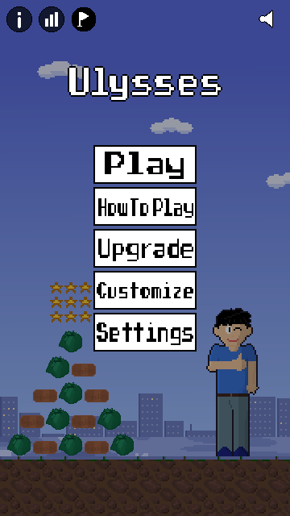
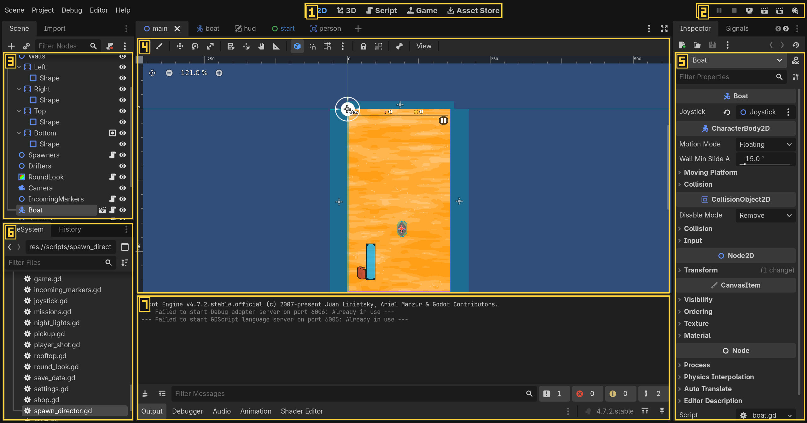
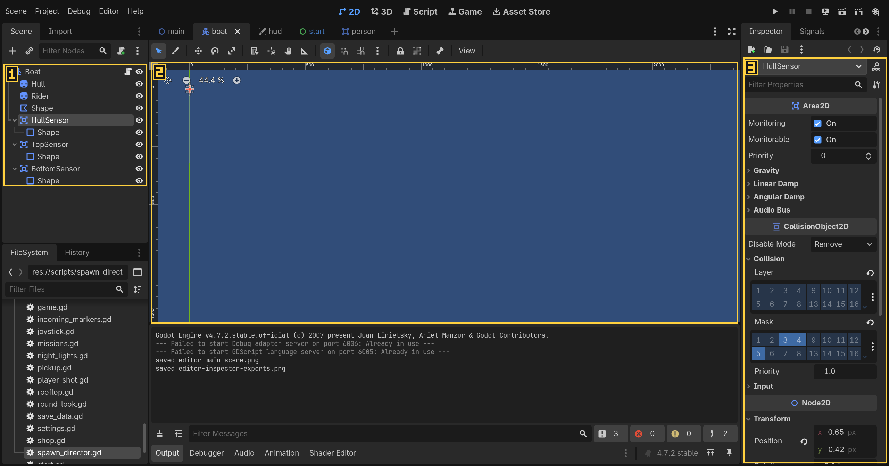
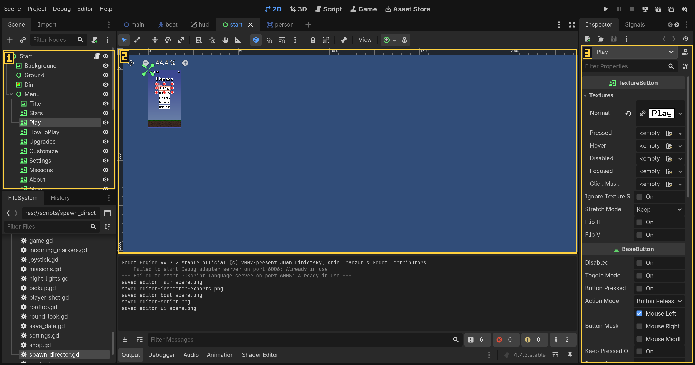
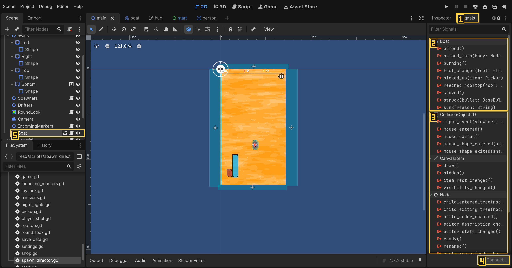
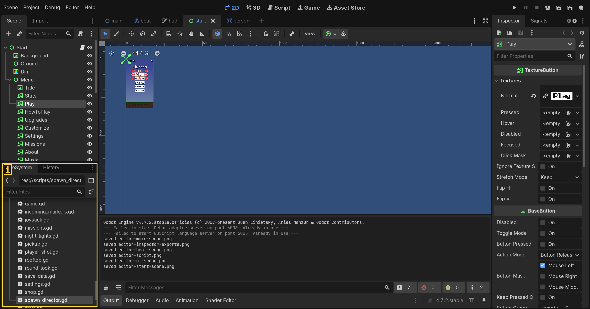
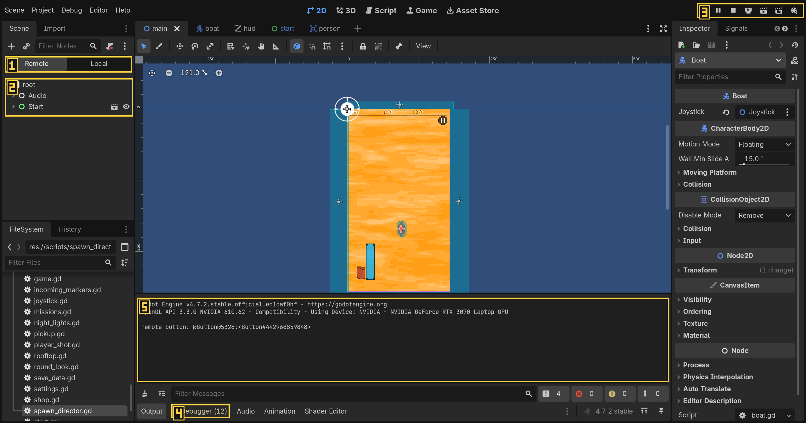
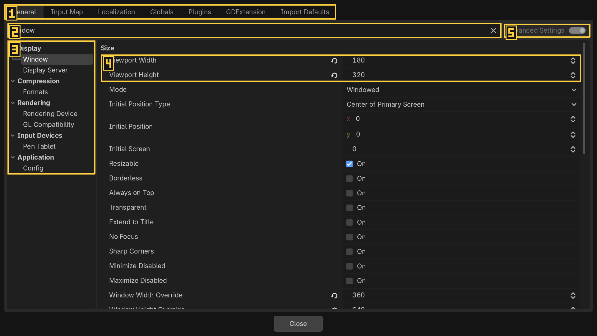
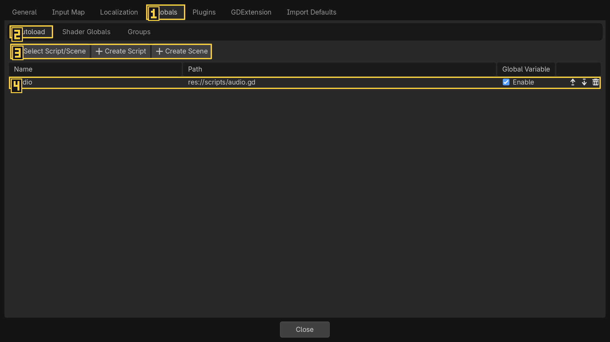
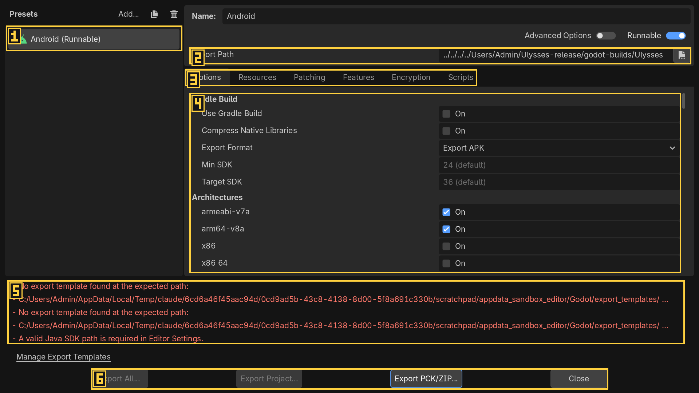

# 2. Getting around Godot



## Install

1. Download **Godot 4.7.2, standard** (not .NET) from godotengine.org. It is one `.exe`; there is no installer. Keep it anywhere (this project's machine keeps it in `C:\Users\Admin\Godot\`).
2. The "console" build (`..._console.exe`) also prints to a terminal, which you want for headless tests and exports.

## Open the project

1. Start Godot. The **Project Manager** opens.
2. **Import** → select `ulysses-godot/project.godot` → **Import & Edit**.
3. The first open imports every PNG and sound into a hidden `.godot/` cache. That cache is rebuilt from the files, so it is never committed (like `node_modules`).

From a terminal:

```
godot --path ulysses-godot -e        # open the editor
godot --path ulysses-godot           # run the game
godot --path ulysses-godot -- --seed=20261122   # run a given course (chapter 6)
```

## A tour of the editor

The pictures in this chapter are the real editor with Ulysses open. Yellow boxes are numbered; the list under each picture says what each one is and what you do there.

### The main window



1. **Main screens**: 2D, 3D, Script, Game, Asset Store. Ulysses lives in **2D** (scenes) and **Script** (code). Clicking a script icon in the Scene dock switches to Script for you. **Game** shows the running game inside the editor.
2. **Run buttons**: run the project (F5), pause, stop (F8), run the current scene (F6), run a chosen scene. Hidden under the badge is the ▶ button itself.
3. **Scene dock**: the node tree of the open scene (here `main.tscn`). Click a node to select it; drag to reorder or re-parent; right-click for *Add Child Node*, *Instantiate Child Scene*, *Attach Script*, *Make Local*. The icons on the right of a row: a scroll (it has a script), a clapper (it is an instanced scene; click to open it), an eye (visible in the editor).
4. **Viewport**: the scene drawn at its real size. The orange rectangle is the 180 × 320 game screen. Select with Q, move with W, rotate with E, scale with S; the mouse wheel zooms and the middle button pans. The toolbar above it holds snapping, the grid, lock and group.
5. **Inspector**: every property of the selected node (the Boat), grouped by class from the most specific down: `Boat` (the script's exported variables, here `Joystick`), `CharacterBody2D`, `CollisionObject2D`, `Node2D`, `CanvasItem`, `Node`. A ↺ arrow beside a value means "changed from the default": click it to reset. At the bottom, **Script** shows the attached script.
6. **FileSystem**: everything under `res://` (the project folder). Double-click a scene to open it, a script to edit it, an image to preview it. Drag a file onto a property in the Inspector to assign it (for example a PNG onto *Texture*).
7. **Bottom panel**: **Output** (your `print()`s and engine messages), **Debugger** (errors, breakpoints, the profiler), **Audio** (the mixer's buses), **Animation**, **Shader Editor**. The lines here are harmless notices from a second editor running on the same machine.

**Try it:** select `Boat` in 3, then in 5 open *Transform* and change *Position*; the boat moves in 4. Press Ctrl+Z to undo.

### A scene of its own: the boat



Double-click `scenes/boat.tscn` in FileSystem (or the clapper icon next to `Boat` in the main scene) and it opens in a new tab.

1. **The boat's nodes**: `Boat` (CharacterBody2D) with two sprites (`Hull`, `Rider`), its collision `Shape`, and three `Area2D` sensors, each with its own shape. Chapter 5 explains each sensor.
2. **Viewport**: zoomed out here; the boat sits at the origin (the red and green axis lines). Press F with a node selected to frame it.
3. **Inspector for `HullSensor`**: *Monitoring* (it detects others) and *Monitorable* (others detect it). Under **Collision**, *Layer* is what this area **is** and *Mask* what it **looks for**: here the mask has 3 (obstacles), 4 (props) and 5 (pickups) lit. Click a number to toggle it; hover it to see the layer's name from Project Settings → Layer Names.

### The start screen and its buttons



1. **The menu's nodes**: `Background`, `Ground` and `Dim` behind; `Menu` holds the `Title` and one `TextureButton` per menu entry (Play, How to Play, Upgrades, Customize, Settings, Missions, About).
2. **Viewport**: the whole 180 × 320 screen; the small red dots are the selected button's resize handles.
3. **Inspector for `Play`**: a TextureButton shows an image per state. *Normal* is set (the "Play" picture); *Pressed* and *Hover* are empty because `button_feel.gd` does those in code (chapter 8). Below, `BaseButton` settings: *Disabled*, *Toggle Mode*, and *Action Mode* (fire on press or on release).

**Wiring a button:** select it, open the **Signals** tab beside the Inspector, double-click `pressed()`, and pick the node whose script should answer. Ulysses wires its buttons in code instead (`$Menu/Play.pressed.connect(play)` in `start.gd`), which keeps every connection searchable in one file.

### The Signals tab



1. **Signals**: the tab next to Inspector.
2. **The node's own signals**, declared with `signal` in `boat.gd`: `bumped`, `fuel_changed(fuel)`, `picked_up(item)`, `reached_rooftop(roof)`, `struck(bullet)`, `sunk(reason)` and more. Hovering one shows its doc comment.
3. **Inherited signals** from the classes the Boat extends (`CollisionObject2D`, `CanvasItem`, `Node`): `input_event`, `visibility_changed`, `ready`...
4. **Connect...**: connects the selected signal to a method, the same as `signal.connect(method)` in code. A connection made here is saved in the `.tscn` and shows a green icon in the script's margin.
5. **The selected node**, `Boat`, in the main scene.

### The FileSystem dock



1. **FileSystem** at `res://scripts/`: one script per job (chapter 4 lists them). The path bar at the top accepts a typed path; the filter box finds a file by name; the button to the right of the path switches between tree and grid views. Right-click a file for *Show in File Manager*, *Rename*, *Duplicate*, *View Owners* (which scenes use it), and *Move To*. Always move and rename files **here**, not in Windows Explorer: Godot then updates every scene that points at them.

## Running and debugging



1. **Remote / Local**: while the game runs, the Scene dock gets two buttons. *Local* is the scene file; *Remote* is the live tree inside the running game.
2. **The live tree**: `root` holds `Audio` (the autoload, chapter 10) and `Start` (the scene being shown). Start a run and `Main` replaces `Start`; open `Main/Drifters` and you can watch cars and pickups appear and vanish. Click a node and the Inspector shows its live values, which you can change while it runs.
3. **Run controls while running**: the first button became ↻ (restart), then pause and stop.
4. **Debugger**: the number in brackets counts new entries. Its tabs: *Stack Trace* (where a breakpoint stopped), *Errors*, *Profiler* (time per function), *Visual Profiler*, *Monitors* (FPS, memory, node count, like a metrics dashboard), *Video RAM*.
5. **Output**: the game's `print()` lines and engine messages appear here.

- **F5** runs the main scene (`project.godot` sets `start.tscn`). **F6** runs the open scene alone, handy for `main.tscn`.
- `print()` writes to the **Output** panel (and the terminal with the console build).
- Click left of a line number to set a **breakpoint**; the **Debugger** panel then shows variables and the call stack, like any IDE debugger.
- While running, the **Remote** tab of the Scene panel shows the live scene tree: you can watch nodes appear (cars, bullets) and change properties on the fly.
- Errors appear in the **Debugger → Errors** tab with a file and line.

## Project settings worth knowing

`project.godot` (Project → Project Settings) holds what a backend calls environment config. Ulysses sets:

- **Display → Window**: a 180 × 320 viewport (the released game's pixel size), stretched to fit the phone screen with nearest-neighbour filtering, so pixel art stays sharp.
- **Rendering**: the **Compatibility** renderer, which runs on older phones (OpenGL ES 3). Every shader in this game is written for it.
- **Autoload**: `Audio`, the one global service.
- **Application → Run → Main Scene**: `scenes/start.tscn`.



1. **Tabs**: *General* (all settings), *Input Map* (named actions and their keys), *Localization*, *Globals* (autoloads, shader globals, groups), *Plugins*, *GDExtension*, *Import Defaults*.
2. **Filter**: type part of a setting's name ("window", "stretch", "renderer") instead of hunting through sections.
3. **Sections**: the filtered sections. Here *Display → Window* is selected.
4. **Viewport Width / Height = 180 × 320**: the game's own resolution. The ↺ arrows show these differ from Godot's defaults. Scroll down for *Window Width/Height Override* (360 × 640, the window size on a desktop) and **Stretch** (*Mode* `canvas_items`, *Scale Mode* `integer`), which scale the 180 × 320 picture up in whole pixels.
5. **Advanced Settings**: turn it on to see every setting; off shows the common ones only.

Every change here is written to `project.godot` as text, for example:

```ini
[display]
window/size/viewport_width=180
window/size/viewport_height=320
```



1. **Globals**.
2. **Autoload**: scripts or scenes created at startup and kept for the whole run.
3. **Add one**: *Select Script/Scene* picks an existing file; the *Name* becomes a global (`Audio`).
4. **Ulysses' one autoload**: `Audio` → `res://scripts/audio.gd`, *Global Variable* enabled, so any script can call `Audio.play("coin")`. The arrows reorder autoloads (they load top to bottom); the bin removes one.

## Scenes are text files

`.tscn` files are plain text, so they diff and merge in git. Open one in a text editor and you will see nodes and their properties:

```
[node name="Boat" parent="." instance=ExtResource("4_boat")]
position = Vector2(94.8, 209.92)
joystick = NodePath("../Joystick")
```

This project edits scenes both in the editor and as text. One rule if you do both: **close the scene in the editor before editing its file by hand**, or the editor saves its old copy over yours.

## Exporting to Android (the short version)

Chapter 11 has the details. In short:

1. Install the **export templates** (Editor → Manage Export Templates) and, for Android, a JDK 17 and the Android SDK, set in Editor Settings → Export → Android.
2. Project → Export → the **Android** preset is already saved in `export_presets.cfg`.
3. From a terminal: `godot --path ulysses-godot --headless --export-debug "Android" <path>.apk`.



1. **Presets**: one per target. Ulysses has *Android (Runnable)*; "Runnable" means the ▶ button's phone icon can install it on a connected device. *Add...* creates presets for Windows, Web, iOS and others.
2. **Export Path**: where the file goes. Ulysses' builds go to a folder outside the repo, never inside it.
3. **Preset tabs**: *Options* (below), *Resources* (which files to include), *Features*, *Encryption*, *Scripts*.
4. **Options**: *Export Format* (APK for testing, AAB for the Play Store), *Min/Target SDK*, and **Architectures**: `armeabi-v7a` and `arm64-v8a` (real phones) are on; `x86` and `x86_64` (emulators) are off to keep the file small. Further down: the package name, version, icons, and **Permissions** (Ulysses turns on *Vibrate*).
5. **What is missing**: red lines list what stops an export. This picture was taken from a fresh editor profile, so it shows the two usual first-time problems: **no export templates** (fix: *Manage Export Templates* just below, then *Download and Install*) and **no Java SDK** (fix: Editor → Editor Settings → Export → Android → *Java SDK Path*). On a machine set up as in chapter 11 the list is empty.
6. **Export**: *Export Project...* builds the APK (it asks debug or release); *Export PCK/ZIP* exports only the game data; *Export All* runs every preset.

A debug build is signed with a debug key and installs alongside the Play Store app (its package name ends in `.godot`).
