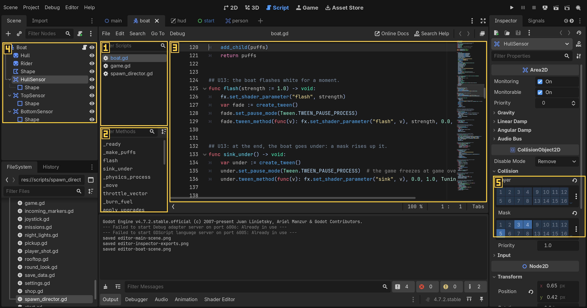

# 3. Learning GDScript

GDScript is Godot's own language. It looks like Python (indentation, `func`, `var`), has optional static types like TypeScript, and is built around the engine: nodes, signals and resources are first-class. If you know Python or TypeScript, you can read it on day one.

## Why GDScript (and the alternatives)

| Option | Good | Less good | Why not here |
|---|---|---|---|
| **GDScript** | Built into the editor, no build step, instant reload, best docs and examples, exports everywhere including the web | Slower than C# for heavy maths | **Chosen.** The game is small and logic-light; fast iteration wins |
| **C#** (.NET build) | Familiar to many backend devs, strong typing, NuGet | Separate Godot build, slower edit loop, web export limited | Not needed for this size of game |
| **C++ / GDExtension** | Maximum speed | Compiling, build tooling | Overkill |
| **Visual scripting** | — | Removed in Godot 4 | — |

## The script editor



1. **Open scripts**: every script you have open. Click one to switch; middle-click to close. The filter box above finds one by name.
2. **Methods of this script**: click one to jump to it. In a long file like `game.gd` this is the quickest way around.
3. **The code**: here `boat.gd` around line 120, where `flash()` and `sink_under()` live. Ctrl+click a name (a function, a class, `Tween`) to jump to it, or to the built-in class reference. Ctrl+Space completes; F1 searches the docs. Click left of a line number to set a breakpoint (a red dot).
4. **The scene tree stays visible**: drag a node from here into the code and Godot writes its path (`$Hull`). Hold Ctrl while dropping and it writes `@onready var hull: Sprite2D = $Hull`.
5. **The Inspector stays visible too**: the selected node's properties, here the Boat's collision layer and mask.

Errors show in red at the bottom of the editor as you type (a parse error stops the script from loading), and the editor saves and reloads a script the moment you run the game.

## A tour of the language through Ulysses

### Files are classes

Each `.gd` file is a class. `extends` picks the node type; `class_name` makes it a named global type.

```gdscript
class_name Boat
extends CharacterBody2D
## Two hashes start a doc comment: it shows in the editor's help.
```

### Variables, types and constants

```gdscript
var fuel := Tuning.FULL_FUEL          # ":=" infers the type (float here)
var seats: int = 3                    # an explicit type
const SEATS := 3                      # a constant
@export var joystick: Joystick        # shows in the Inspector; set it in the editor
@onready var _hull_sensor: Area2D = $HullSensor  # set once the node is ready
```

Typed code is faster and catches mistakes in the editor. This project types almost everything.

`$HullSensor` is shorthand for `get_node("HullSensor")`: a path in the scene tree. `%FireButton` finds a node marked "unique name" anywhere in the scene, so moving it in the tree doesn't break the path.

### Functions and the lifecycle

```gdscript
func _ready() -> void:            # once, when the node enters the scene (like a constructor that can see its children)
func _process(delta) -> void:     # every drawn frame
func _physics_process(delta):     # every physics tick (60/s)
func _input(event) -> void:       # every input event (touch, key)
func _notification(what) -> void: # engine events: app paused, window closing...
```

Order matters: children are ready before their parent. `game.gd` (the root) can therefore use the boat and the director in its `_ready`.

### Signals

```gdscript
signal picked_up(item: Pickup)        # declare
picked_up.emit(area)                  # publish
boat.picked_up.connect(_on_picked_up) # subscribe
boat.bumped.connect(Audio.play.bind("hit"))  # bind fixes an argument
```

### Lambdas (anonymous functions)

```gdscript
var choices := range(_left.size()).filter(func(i): return _left[i] != _last)
boat.bumped.connect(func(): _since_bump = 0.0)
```

### Static functions and static variables

A static function needs no instance, like a utility method. A static variable is shared by everyone, like a class-level field.

```gdscript
static func daily_seed() -> int: ...           # SpawnDirector.daily_seed()
static var requested := false                  # Tutorial.requested
```

Ulysses uses static vars for small cross-scene messages: the start screen sets `Tutorial.requested = true`, then the game scene reads it as it starts.

### Inner classes

```gdscript
class Bag:                      # spawn_director.gd's shuffle bag
	var _contents: Array = []
	func draw(fits := Callable()): ...
```

### Dictionaries and arrays

```gdscript
var info := {"name": "Helicopter", "attack": "crates"}
info.name              # dot access works on dictionaries
var ids: Array = [0, 2, 4]
ids.has(2)
```

### Await and timers

```gdscript
get_tree().create_timer(1.5).timeout.connect(finish)   # call later
await get_tree().create_timer(1.5).timeout              # or pause this function
```

Never block with a loop or a sleep: the whole game would freeze. Timers, tweens and counters in `_process` are the game equivalents of scheduled jobs.

### Tweens: animating a value over time

```gdscript
var fade := create_tween()
fade.tween_property(sprite, "self_modulate", Color.WHITE, 0.15)
```

A tween changes a property smoothly over a duration: flashes, fades, slides, pulses. Ulysses uses them for hit flashes, the "New high score!" pulse, the night fade and the boss wind-up.

## Traps we actually hit (and how to avoid them)

These all happened while building this game:

1. **Lambdas capture locals by value.** A lambda that changes an outer `int` changes its own copy. Share a Dictionary instead: `var last := {"clear": Vector2.ZERO}` and set `last.clear` inside the lambda.
2. **A freed node compares equal to `null`.** After `queue_free()`, `node != null` can still be true *or* false depending on timing; use `is_instance_valid(node)`, and keep your own bool if you need "it existed and is gone".
3. **Name clashes with built-ins.** A function called `_draw()` overrides `CanvasItem._draw` (a drawing callback) and fails; a variable called `name` shadows `Node.name`. Pick distinct names (`_draw_any`, `which`).
4. **Type inference needs a known type.** `var x := some_dictionary.value` fails to infer; write `var x: float = ...`.
5. **Duplicate names in one function.** Declaring `var in_row` twice in a function is a parse error, and a script without `class_name` may only report it when it runs. Run the scene after every change.
6. **Autoloads and compile order.** A test script that names a class at the top (`Boss`) compiles it before autoloads like `Audio` exist, and fails. Load such scripts at run time with `load("res://scripts/boss.gd")`.
7. **Setting size before adding a Control.** A `Button` resizes itself to its theme's minimum when added to the tree; set `position` and `size` after `add_child`.
8. **Shaders: `COLOR` already includes the texture.** In a canvas shader's `fragment()`, multiplying the texture by `COLOR` again squares the colours. Save the vertex colour in `vertex()` and multiply by that.
9. **Windows line endings in scene files.** A script that edited `.tscn` files on Windows wrote `\r\n` line endings. Inside a multi-line `text = "..."` the extra `\r` counts as a line break, so every line of the About page came out double-spaced. Godot projects keep text files in LF (this one's `.gitattributes` says `eol=lf`); write them with LF, and check with `grep -c $'\r' file`.

## A study path

1. **The official "Getting Started" and "Your first 2D game"** (docs.godotengine.org): a dodge game in an afternoon. It teaches nodes, scenes, signals and input, and is the closest small sibling of Ulysses.
2. **GDScript reference** (docs.godotengine.org → GDScript): read "GDScript basics" and "Static typing" once.
3. **Read Ulysses in this order**: `tuning.gd` (the numbers), `boat.gd` (one object's behaviour), `game.gd` (the run), `spawn_director.gd` (the hardest and most interesting system).
4. **Change something and watch it** (chapter 13 has a list).
5. **Godot's class reference** inside the editor (F1, or Ctrl-click any type): every node's properties, methods and signals, with examples.
6. Communities: the Godot docs' tutorials section, GDQuest (free guides and courses), and the Godot forum.
