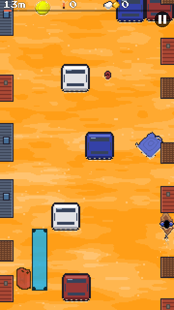
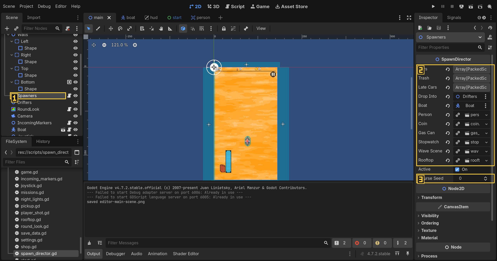

# 4. The architecture of Ulysses



## Two scenes and a set of panels

| Scene | Role | Backend analogy |
|---|---|---|
| `scenes/start.tscn` + `start.gd` | The menu: Play, How to Play, Upgrades, Customize, Settings, About, Stats, Missions | The landing page / API gateway |
| `scenes/main.tscn` + `game.gd` | One run, from launch to game over | One request (or one session) |
| `scenes/ui/*.tscn` | Panels instanced in both: shop, customize, settings, the HUD | Shared components |

Going from the menu to a run is `get_tree().change_scene_to_file("res://scenes/main.tscn")`: the old scene is freed and the new one built, like a fresh request. Anything that must survive the switch lives in the save file (persistent) or a static variable (a one-off message, such as "start the Daily").

## The game scene, node by node

```
Main (Node2D, game.gd)                 the run: score, ending, saving, Continue
├── Water (Node2D)
│   └── Surface (ColorRect, water_surface.gd + water.gdshader)   the flood
├── Banks (Node2D, banks.gd)           rooftops along both edges (drawn over everything below)
├── Walls (Node2D)                     four StaticBody2D walls around the screen
├── Spawners (Node2D, spawn_director.gd)   decides what enters the flood
├── Drifters (Node2D)                  where everything that drifts is added
├── RoundLook (CanvasModulate, round_look.gd)  the tint per round, rain at night
├── Camera (Camera2D)                  screen shake
├── IncomingMarkers (Node2D)           triangles above cars about to enter
├── Joystick (Node2D, joystick.gd)     the touch stick
├── Director (Node, director.gd)       rounds, speed-ups, bosses, firing
├── Boat (boat.tscn, boat.gd)          the player
└── HUD (hud.tscn, CanvasLayer)        counters, fuel gauge, game over, pause, shop...
```

In the editor, select `Spawners` and the Inspector shows the variables `spawn_director.gd` marks with `@export`:



1. **`Spawners`** selected in the main scene.
2. **Exported variables**, set in the editor, not in code: *Cars* and *Trash* (arrays of scenes to choose from), *Late Cars* (more scenes added after round 3), *Drop Into* (the `Drifters` node), *Boat*, and one scene each for *Person*, *Coin*, *Gas Can*, *Stopwatch*, *Wave Scene* and *Rooftop*. Click an array to expand it; drag a `.tscn` from FileSystem onto an empty slot to add a hazard. No code changes.
3. **Course Seed**: 0 means a new random course each run; any other number replays the same course (chapter 6).

```gdscript
@export var cars: Array[PackedScene] = []
@export var drop_into: Node2D
@export var course_seed: int = 0
```

`@export` is dependency injection: the script says what it needs, the scene supplies it. A typed export (`Array[PackedScene]`, `Node2D`) also stops you from dropping the wrong kind of thing into the slot.

Why one `Drifters` node? Everything that moves down the screen (cars, trash, pickups, waves, rooftops, bullets) is a child of it. Clearing the board after a Continue or a test is one loop over its children, and the spawn director never needs to know about the boat.

## Scripts by job

| Script | Job | Notes |
|---|---|---|
| `tuning.gd` | Every number: speeds, chances, prices, timings | The game's config file. Change balance here only |
| `flow.gd` | `Flow.speed`: how fast the flood moves now | A static variable everything reads |
| `save_data.gd` | Load and save `user://save.cfg` | The game's "database layer" |
| `audio.gd` | Music and sound effects (autoload) | A global service |
| `characters.gd` | Riders and boats: art, prices, traits | Static data, like a lookup table |
| `game.gd` | One run: score, rescues, coins, ending, Continue, missions, banking | The orchestrator |
| `boat.gd` | Moving, fuel, sensors, crushing, flashes, the engine, passengers | The player |
| `joystick.gd` | Touch and mouse input to a direction | An input adapter |
| `director.gd` | Rounds, speed-ups, boss fights, firing, the stopwatch slow-down | The level's state machine |
| `spawn_director.gd` | Everything that enters the flood | Procedural generation (chapter 6) |
| `boss.gd`, `boss_bullet.gd`, `player_shot.gd`, `crate_drop.gd`, `boss_warning.gd` | Boss fights | Chapter 7 |
| `drifter.gd`, `pickup.gd`, `wave.gd`, `rooftop.gd` | Things that drift down | Each moves itself by `Flow.speed` |
| `missions.gd`, `tutorial.gd` | Goals and the first-run tutorial | Chapter 8 |
| `start.gd`, `shop.gd`, `customize.gd`, `settings.gd`, `fuel_bar.gd`, `fire_button.gd`, `button_feel.gd` | Menus and UI | Chapter 8 |
| `round_look.gd`, `water_surface.gd`, `banks.gd`, `incoming_markers.gd`, `night_lights.gd` | Look and atmosphere | Chapter 9 |

## How data flows in a run

```
input ──► Joystick.direction ──► Boat._move()  ──► move_and_slide()
                                     │
            Boat sensors ── signals ─┼─► game.gd: picked_up, reached_rooftop, bumped, sunk
                                     │
Director ── Flow.speed ──────────────┼─► everything that drifts reads Flow.speed
         └─ spawns.active / round ───┼─► SpawnDirector decides rows, pickups, gas...
                                     │
game.gd ── end_game() ── SaveData ───┴─► user://save.cfg (score, coins, rescues, missions)
```

Three design rules keep this simple:

1. **Objects report, the game decides.** The boat emits `picked_up(item)`; `game.gd` decides what a coin or a person is worth. One place owns the rules.
2. **Shared state is tiny and explicit.** `Flow.speed` is the only value everything reads each frame. No object reaches into another's internals for it.
3. **Numbers live in `Tuning`.** No magic numbers in game code; a designer can rebalance without reading logic.

## Why not more singletons, or an ECS?

- **Autoloads for everything** (a global `GameState`) would make any script able to change anything: convenient at first, hard to test. Ulysses passes references explicitly (`@export var boat: Boat`, set in the scene) so each script states what it depends on, like dependency injection.
- **An entity-component system** (ECS) pays off with thousands of similar objects. Ulysses has at most a few dozen; Godot's node tree is simpler and fast enough.
- **One giant script** would be quicker to start and impossible to change safely. The split above came from adding features one at a time and moving each into the script that owned it.

## The Unity origin

Ulysses started as a Unity prototype (`game project1/`). The port kept its screen size, speeds and collision shapes, and replaced Unity patterns with Godot ones:

| Unity | Godot |
|---|---|
| `MonoBehaviour` | A script extending a node |
| `GameObject.Find` every frame | References set once (`@export`, `$Node`) |
| Prefab | Scene (`.tscn`) |
| `OnTriggerEnter2D` | `Area2D.body_entered` / `area_entered` signals |
| `Rigidbody2D` velocity | `CharacterBody2D.move_and_slide()` or moving the node directly |
| Coroutine | `await`, timers and tweens |
| `PlayerPrefs` | `ConfigFile` in `user://` |
