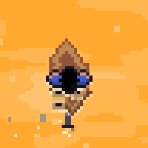
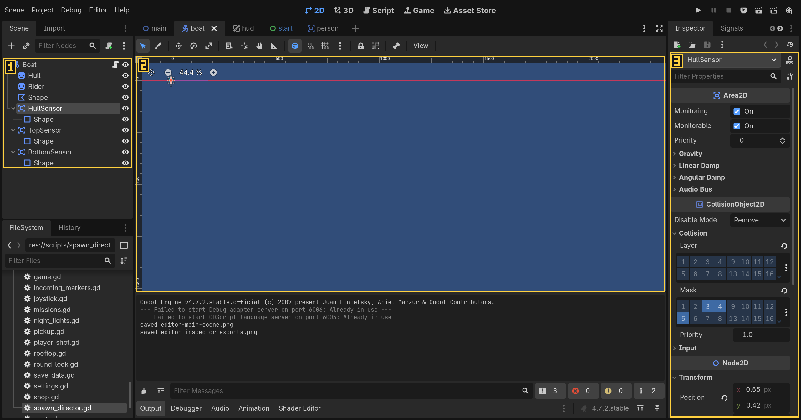

# 5. The boat and the core rules



## Steering: the touch stick

**In play:** press anywhere and drag; the further you drag (up to 32 px), the faster you go.

**Godot feature:** `_input(event)` receives `InputEventScreenTouch`/`InputEventMouseButton` and `...Drag`/`...Motion` events. `joystick.gd` turns them into a `direction` vector of length 0 to 1:

```gdscript
direction = reach / Tuning.STICK_RADIUS   # reach: drag offset, limited to the radius
```

**Alternatives:** Godot's built-in `TouchScreenButton`, or Input Map actions (`Input.get_vector`) for keyboards and gamepads. A floating stick that appears where you press suits a phone game played one-handed, so it is custom.

## Moving: CharacterBody2D, momentum and the current

**In play:** the boat eases up to speed in 0.15 s and eases to a stop; let go and the flood carries it slowly down.

**Godot feature:** `CharacterBody2D` is a physics body you move yourself: set `velocity`, call `move_and_slide()`, and Godot slides you along walls and cars instead of passing through them.

```gdscript
func _move(delta: float) -> void:
	var target := throttle_vector() * speed
	# momentum: approach the stick's velocity at a fixed acceleration
	_steer_velocity = _steer_velocity.move_toward(target, speed / Tuning.BOAT_MOMENTUM * delta)
	velocity = _steer_velocity
	# the current (or a car on the bow, which carries the boat at its own speed)
	velocity.y += Flow.speed if _top_contacts > 0 else Flow.speed * Tuning.CURRENT_SHARE
	if _shove_left > 0.0:              # a wave hit us
		_shove_left -= delta
		velocity.y += Tuning.WAVE_SHOVE_SPEED
	velocity += wind                   # Typhoon Ulysses' gusts
	move_and_slide()
```

**Why these choices:**
- **`move_toward` for momentum** gives a constant acceleration that reaches full speed in exactly `BOAT_MOMENTUM` seconds, easy to test (the U9 test measures 0.15 s). `lerp` would ease more softly but never quite arrive.
- **The current** (a quarter of the flow) makes standing still cost a little fuel. Before it, the best strategy was to sit still; games should reward playing.
- **`RigidBody2D`** (full physics) was the alternative; it makes boats bump and spin realistically but is harder to control precisely. An arcade game wants exact, predictable movement.

## Fuel: burn follows the throttle

```gdscript
func _burn_fuel(delta: float) -> void:
	var throttle := throttle_vector().length()     # 0..1: how far the stick is pushed
	if throttle <= 0.0:
		return
	fuel = maxf(fuel - burn_rate * throttle * delta, 0.0)
	fuel_changed.emit(fuel)                         # the gauge listens
	burning.emit()
```

Gentle steering burns less; a light push to hold still against the current costs about 5 fuel a second. The fuel gauge (`fuel_bar.gd`, a `TextureProgressBar`) never reads the boat; it listens to `fuel_changed`.

## Sensors: Area2D and collision layers

**In play:** touching a coin collects it; a car on the bow pins you; trash bumps you.

**Godot feature:** an `Area2D` detects overlaps without blocking. Its **collision layer** says what it *is*, its **mask** what it *looks for*. Ulysses' layers:

| Layer | Bit | What |
|---|---|---|
| walls | 2 | the four walls |
| obstacles | 4 | cars, the tree, the post |
| props | 8 | trash |
| pickups | 16 | people, coins, gas cans, stopwatches, waves, rooftops, boss bullets |
| boss | 32 | bosses (the player's shots look for this) |

The boat has three sensors. Open `scenes/boat.tscn` and select one to see its layer and mask in the Inspector (chapter 2 walks through this picture):




- **HullSensor** (mask obstacles + props + pickups): `area_entered` → a pickup, bullet, wave or rooftop; `body_entered` → a bump.
- **TopSensor** at the bow (mask obstacles): counts cars resting on the bow.
- **BottomSensor** at the stern (mask walls): counts contact with the bottom wall.

```gdscript
func _check_sunk() -> void:
	if fuel <= 0.0:
		_sink("out_of_fuel")
	elif _top_contacts > 0 and _bottom_contacts > 0 and not is_safe():
		_sink("squeezed")     # a car pins the boat against the bottom wall
```

**Alternative:** check distances between objects every frame in code. Areas let the physics engine do the broad work (and are how the Unity prototype's triggers translate).

## Pickups: the boat reports, the game decides

```gdscript
# boat.gd
func _on_pickup_reached(area: Area2D) -> void:
	if area is Pickup: picked_up.emit(area)
	elif area is BossBullet: struck.emit(area)
	elif area is Wave: ...shove...
	elif area is Rooftop: reached_rooftop.emit(area)

# game.gd
func _on_picked_up(item: Pickup) -> void:
	match item.kind:
		Pickup.Kind.PERSON:  # climb aboard if there is a seat
		Pickup.Kind.COIN:    coins += Tuning.COINS_PER_PICKUP
		Pickup.Kind.GAS_CAN: boat.refuel(...)
		Pickup.Kind.STOPWATCH: $Director.slow_flow(Tuning.STOPWATCH_SECONDS)
```

`match` is GDScript's `switch`. One `Pickup` script with an enum keeps all pickups alike (drift, outline shader, removal) while the game decides what each is worth.

## Carrying people and the rooftop

People climb aboard (3 seats, 4 on the rafts) and only count as rescued when dropped on a rooftop. Each drop-off in a row adds a bonus; a crush loses everyone aboard. The rule lives in `game.gd` (`_on_rooftop`, `_on_boat_sunk`); the boat only shows passengers (`show_passengers(n)` adds small head sprites).

**Why:** a rescue you can lose is a decision ("go for the roof now, or grab one more?"). This turned rescues from passive collecting into the game's main risk/reward.

## Score, Continue and the end of a run

```gdscript
func score() -> int:
	return int(distance / Tuning.METRES_PER_POINT) + rescued * Tuning.POINTS_PER_RESCUE \
		+ bosses * Tuning.POINTS_PER_BOSS + bonus
```

On `sunk`, `end_game()` freezes the world (`get_tree().paused = true`; the HUD keeps running because its `process_mode` is *Always*), banks coins and rescues, settles missions and shows the panel. Continue costs 100, then 200 coins, two per run; it revives the boat with two seconds of safety and clears nearby hazards.

## Boat traits

Each boat in `characters.gd` has speed and tank modifiers and maybe a trait. `boat.apply_upgrades()` applies them when a run starts:

- **slim** (kayak): the collision polygon and hull sensor are rebuilt 70% as wide (from the original shapes, so applying twice is safe).
- **seat** (rafts): one more seat.
- **magnet** (rescue boat): a child `Area2D` with a 24 px circle; each frame, pickups inside it move toward the boat.

**Alternative:** a scene per boat. A data table plus one boat scene means a new boat is one line in `characters.gd` and one PNG.
