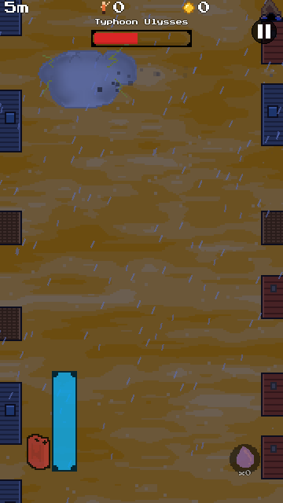

# 7. Bosses



## The round loop (director.gd)

`director.gd` is a small state machine: *in a round* → *boss fight* → *next round*.

- During a round the flood speeds up 5% every 30 s, and a bar shows the distance to the boss.
- At 300 m (`ROUND_DISTANCE`) `start_boss()` switches the spawn director off (`spawns.active = false`), plays the boss music and shows the boss bar and Fire button.
- `_on_boss_defeated()` pays 100 coins, resets the speed (each round starts 10% faster), tells the spawn director how many bosses are beaten, and switches spawning back on.

**Alternative:** a formal state machine class (State objects with enter/exit). With two states, a boolean (`boss == null`) and two functions are clearer.

## Four bosses, four attacks

Every boss shares `boss.gd` and differs by data in `Director.BOSSES`:

| Boss | `attack` | What it does |
|---|---|---|
| Boat Boss | `fan` | Fans of three bullets from the top |
| Helicopter | `crates` | Fires only the ring, and drops a crate where you are; a shadow warns for 1 s |
| Submarine | `below` | Its fan comes up from below the screen after bubbles show where |
| Typhoon Ulysses | `wind` | Fans, plus gusts that push you sideways (streaks warn first), in a storm |

```gdscript
func fire_wave() -> void:
	match attack():
		"crates":
			_fire_fan(true)      # ring only
			_drop_crate()
		"below":
			_sub_x = position.x
			arena.add_child(BossWarning.bubbles(Vector2(_sub_x, Tuning.SUB_WARNING_Y), Tuning.SUB_WARNING))
			_sub_pending = Tuning.SUB_WARNING
		_:
			_fire_fan(false)
```

**Why data, not subclasses:** four small branches in one script are easier to read than four classes; a fifth boss is a dictionary entry and maybe one branch.

## Fair rings: aim with the same maths you fire with

Each wave includes one collectible **ring** (your ammo). The ring is placed only where the boat can reach it in time, chosen from a shuffle bag so it moves around:

```gdscript
func bullet_velocity(i: int) -> Vector2:      # i = 0 left, 1 middle, 2 right
	var angle := deg_to_rad(Tuning.BOSS_BULLET_FAN * (i - 1))
	var way := Vector2(sin(angle), cos(angle))
	if attack() == "below": way.y = -way.y
	return way * Tuning.BOSS_BULLET_SPEED

func _crossing(i: int) -> Vector2:              # where and when bullet i crosses the boat's height
	var start := volley_start()
	var fly := bullet_velocity(i)
	var gap := target.global_position.y - start.y
	var when := gap / fly.y
	return Vector2(start.x + fly.x * when, when)
```

A real bug taught the rule in the heading: an earlier version fired with `Vector2.DOWN.rotated(angle)` but predicted with `tan(angle)`, which mirrored left and right. Both looked right alone. Now **one function** gives the velocity for both firing and predicting, and a test flies real bullets and compares (800 rings, error 0.0000 px).

## Telegraphs: the boss tells you first

Good boss design warns before it hurts. Every boss swells and glows 0.3 s before a volley (`_wind_up()`, a tween), crates show a growing shadow, the submarine shows bubbles, the typhoon shows wind streaks. At half health a boss smokes (a `CPUParticles2D`), and when beaten it breaks apart in pixel chunks (the `shatter` shader parameter, tweened from 0 to 1).

## Firing back

The Fire button (or Space) spawns a `PlayerShot`, an `Area2D` on the boss layer's mask, that calls `boss.hit()` on contact. Auto-fire (a Settings switch) fires collected rings every 0.4 s. The tutorial reuses the same path with a practice boss that has 1 health and never fires.
