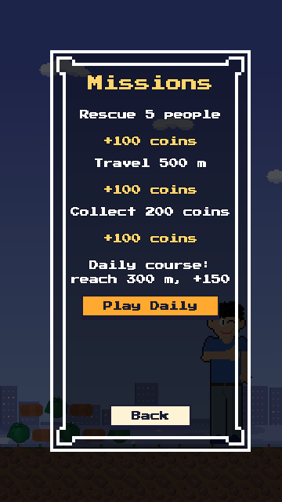
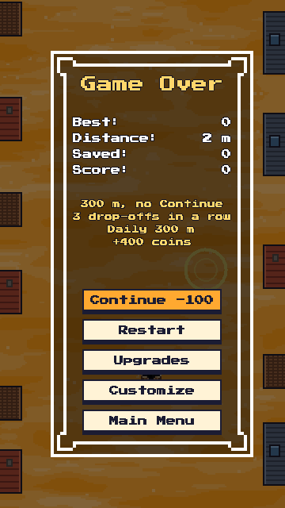
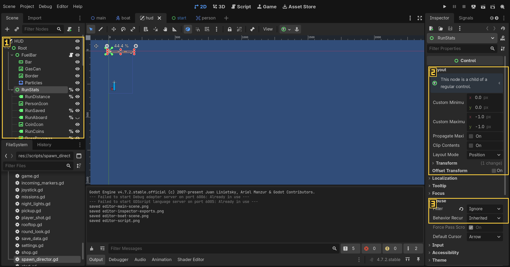
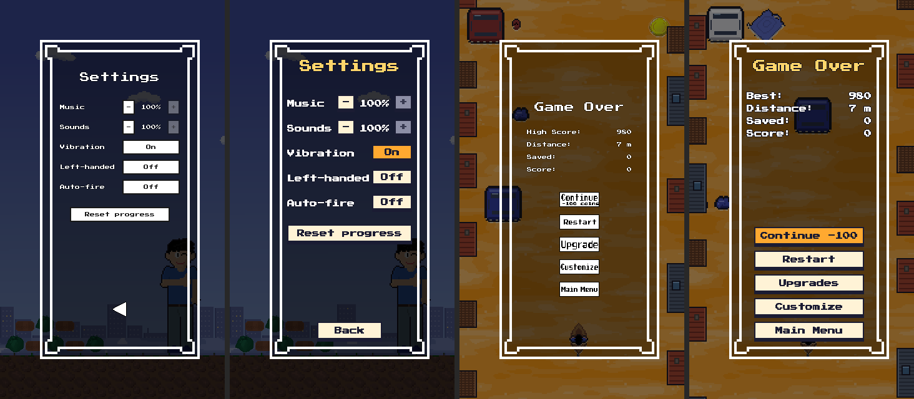
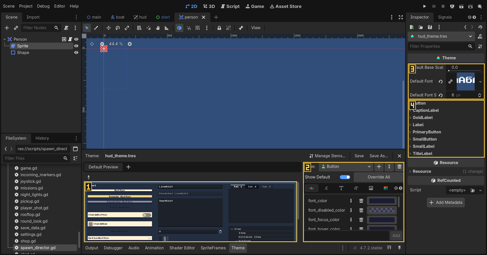
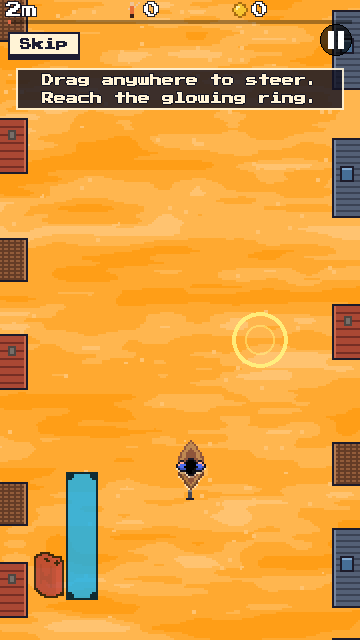

# 8. UI, menus and progression

 

## Control nodes: Godot's UI toolkit

UI in Godot is built from **Control** nodes, the equivalent of HTML elements: `Label` (text), `Button`, `TextureButton` (an image button), `TextureRect` (an image), `ColorRect`, `TextureProgressBar` (the fuel gauge). Each has a position and size (`offset_*`), or anchors for responsive layouts.

Ulysses draws at a fixed 180 × 320 and lets the window stretch it, so most layouts use plain offsets. The HUD sits in a **CanvasLayer**: a separate drawing layer that the camera, the screen shake and the night tint don't affect, like a fixed-position overlay in CSS.



1. **The HUD's nodes**: `HUD` is a CanvasLayer; `Root` is a full-screen Control; inside it `FuelBar`, `RunStats` (the selected Label), `RunDistance`, `PersonIcon`, `CoinIcon`, and further down the panels (pause, game over, shop). Controls show green icons; 2D nodes show blue ones.
2. **Layout**: *Anchors Preset* and the four offsets (left, top, right, bottom) place the Control. Ulysses uses fixed offsets in its 180 × 320 screen; a resizable app would use anchors (the preset menu: *Full Rect*, *Center*, *Top Wide* and so on, like CSS flex alignment).
3. **Mouse Filter**: *Stop* catches clicks (buttons), *Pass* lets the parent see them too, *Ignore* lets them through to what is behind. Labels over the game are set to *Ignore* so they never swallow a touch meant for the joystick.

## Themes: CSS for Godot

`scenes/ui/hud_theme.tres` sets the font (Press Start 2P, a pixel font, at 6 px) and how buttons look in each state (normal, hover, pressed, disabled) as `StyleBoxFlat`s. Set a theme on a parent and every child inherits it, like a stylesheet on `<body>`.

### The UI pass: bigger text, one button style



The first version used 4 px text and a mix of image buttons and thin white boxes. The UI pass changed three things, all in the theme and the panel layouts, not in the game logic:

- **Text sizes with a purpose.** Body text is 6 px, titles 10 px, small print (Customize's boat numbers, the shop's level lines) 5 px, and nothing is smaller. Press Start 2P is exactly *N* px wide per character at size *N*, so a layout can be planned in characters: the panels' inner area is 108 px wide, so a 6 px line holds 17 characters. Where a text didn't fit, it was rewritten instead of shrunk ("High Score:" became "Best:"; a mission became "300 m, no Continue").
- **One chunky pixel button.** A cream face, a 1 px dark border, and a 3 px dark bottom edge that reads as depth. Pressed, the edge shrinks to 1 px and the text moves down 2 px, so the button looks pushed in. Hover is a warmer face; disabled is grey-blue. All text buttons are 16 px tall (12 for the small ones in Customize's grid), easy to hit with a thumb.
- **A primary colour for the main action.** Each page's main button (Resume, Continue, Play Daily, Play the tutorial, a switch that is On) is orange, the flood's colour, so the eye finds it first.

The styles are **type variations**: named variants of a base type, defined in the theme and picked per node with `theme_type_variation`, like a CSS class:

```gdscript
play_daily_button.theme_type_variation = &"PrimaryButton"   # orange instead of cream
label.theme_type_variation = &"GoldLabel"                  # rewards and prices
```

| Variation | Based on | Used for |
|---|---|---|
| `PrimaryButton` | Button | the main action on a page |
| `SmallButton` | Button | 5 px text, Customize's boat grid |
| `TitleLabel` | Label | 10 px gold page titles |
| `GoldLabel` | Label | rewards, "New high score!" |
| `SmallLabel` | Label | 5 px small print |
| `CaptionLabel` | Label | light text on a dark box: the tutorial's prompts over the water |

In the editor it is the node's *Theme Type Variation* property, in the Inspector under *Theme*: type the variation's name there.

Double-click `hud_theme.tres` in FileSystem to open the theme editor:



1. **Preview**: sample Controls drawn with the theme, so you see a change at once (here the cream buttons and the dark text boxes).
2. **Types and items**: pick a type (*Button*, *Label*, *PrimaryButton*...) and edit its items: colours (`font_color`, `font_hover_color`), constants (`line_spacing`, `outline_size`), fonts, sizes and **styles** (the `StyleBoxFlat` per state: `normal`, `hover`, `pressed`, `disabled`). *Add Type* themes a new kind of Control or adds a variation.
3. **Defaults in the Inspector**: *Default Font* (Press Start 2P) and *Default Font Size* (6) apply to every Control under a node that uses this theme.
4. **Every type the theme styles**, the variations included: `Button`, `CaptionLabel`, `GoldLabel`, `Label`, `PrimaryButton`, `SmallButton`, `SmallLabel`, `TitleLabel`. Open one to see and change its items here too.

**Alternatives:** separate `theme_override_*` values on each node (quick for one node, but every panel drifts apart), or a second theme for the menus (more files to keep in step). Variations keep one source of truth.

The big image buttons on the start screen are the released game's art and stay images. `button_feel.gd` gives them feel: brighter under the mouse, slightly smaller while pressed:

```gdscript
static func apply(root: Node) -> void:
	for node in root.find_children("*", "TextureButton", true, false):
		node.mouse_entered.connect(...)   # brighten
		node.button_down.connect(...)     # dip to 94%
```

**Alternative:** separate hover and pressed images for every button (Godot's `texture_hover`/`texture_pressed`). One helper covers every button, including ones added later.

## The HUD

Distance, rescued (with people aboard in gold "2/3"), coins in 8 px numbers beside 8 × 8 icons, each with a dark 2 px outline so they read over the orange water; a bar filling toward the next boss; the fuel gauge, which flashes and beeps below 20%; the Fire button and boss bar during fights; the pause button. `game.gd` updates the numbers in `_show_run_stats()`.

## Screens built in code

Some panels are drawn in the editor (`settings.tscn`, the pause and game-over panels in `hud.tscn`), others built by code (`customize.gd` makes a card per boat; the Missions page duplicates the Stats page and adds a row per mission, its name over its reward, then the Daily and its button). Code wins when the content is data-driven (seven boats, three missions); the editor wins for fixed layouts.

Each panel has a layout test (chapter 12) that checks every visible item sits inside the frame and nothing overlaps, measured with the real font; `check_ui` adds the rules from the UI pass: no text under 5 px, no button under 12 px tall. A two-column table (names left, values right in one box, as on the Stats page) is checked row by row.

The Continue button carries its own price ("Continue -100", then "-200", then "No Continues"), so one control says what it costs and whether it can be used.

## Saving progress: the shop and Customize

Upgrades (tank, engine, fuel saver; three levels each), riders and boats are bought with banked coins. Choices are saved at once with `SaveData.save_all({...})`. Locked items show in grey (a greyscale shader, chapter 9).

## Missions and the Daily

`missions.gd` keeps a pool of 12 one-run goals ("Rescue 5 people", "Drop off 3 at once", "60 s without a bump"...). Three are active, saved as one number. At game over:

```gdscript
var result := Missions.settle(data, run_stats(), rng)   # each met one pays and is replaced
```

`run_stats()` is a snapshot of the run (rescued, distance, coins, bosses, best drop-off, streak, stopwatches, time without a bump, distance before any Continue). Keeping missions as **data plus a pure function** makes them trivial to test and to extend: a new mission is one dictionary line, if its stat exists.

**The Daily**: Play Daily sets a static flag; the spawn director then seeds from today's date, so everyone gets the same course. Reaching 300 m pays 150 coins once per date.

## The tutorial



`tutorial.gd` runs on the very first Play (or from How to Play). It pauses the spawn director and the round director, then walks four steps, each a prompt and a check in `_physics_process`:

1. reach a glowing ring (a small inner class drawing circles with `_draw()`),
2. grab a gas can (the tank is lowered to 35% first),
3. pick up a person and drop them on a rooftop,
4. catch a ring and fire it at a practice boss with 1 health.

Anything missed is dropped again. Skip ends it at once. Then it restores everything and saves `tutorial_done`.

**Alternative:** a separate tutorial scene. Running it inside the real game scene teaches the real controls and needs no duplicate level.

## Settings

Volumes (music and sounds), vibration, a left-handed layout (the Fire button and fuel gauge swap sides) and auto-fire. Settings live in the save file's `settings` section, which Reset progress keeps.
