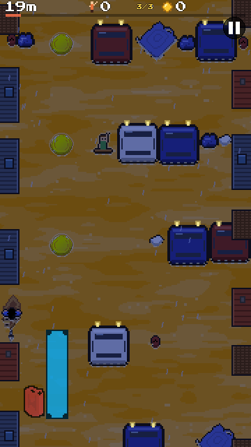
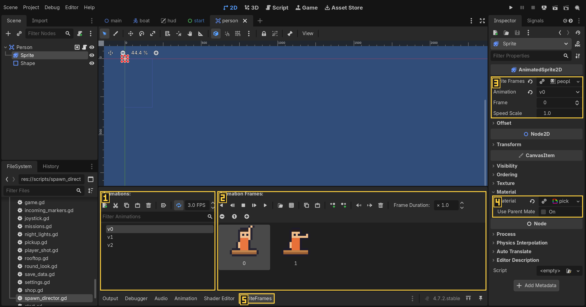
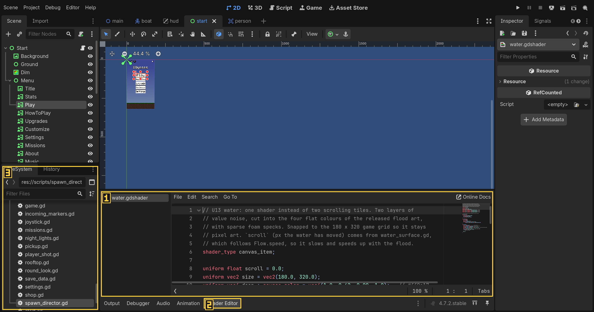

# 9. Visuals



## Pixel art at a fixed size

The game draws at 180 × 320 and is scaled up with **nearest-neighbour** filtering, so pixels stay square and sharp. Every effect is snapped to that grid, so nothing looks smoother than the art.

## Sprites and animations

- **`Sprite2D`** shows one image. A **sheet** (several frames side by side) plus `hframes = 3` and `frame = n` picks one: the boat's lean (left, straight, right) and the engine's propeller.
- **`AnimatedSprite2D`** plays a **`SpriteFrames`** resource: named animations, each a list of frames (`AtlasTexture`s cut from a sheet). Cars ripple, people wave; `people.tres` holds three people (`v0`, `v1`, `v2`) and `pickup.gd` plays one at random.



1. **Animations**: `v0`, `v1`, `v2`, one per person. The buttons above add, copy and delete animations; per animation you set the speed (FPS) and whether it loops.
2. **Frames** of the selected animation. *Add frames from sprite sheet* (the grid icon) cuts a sheet into frames: choose the rows and columns, click the cells you want.
3. **Sprite Frames**: the `AnimatedSprite2D`'s property holding this resource. Because it is a `.tres` file, every person scene shares it.
4. **Material**: `pickup.tres` (the waterline and outline shader below).
5. **SpriteFrames** tab: the editor opens here in the bottom panel when you click a SpriteFrames resource.

- **`AtlasTexture`** is a region of a bigger texture. The start screen's figures use one, moving its region over a three-frame sheet (`Player/Animated/`): idle, a breath (head and shoulders 1 px lower) and a small hop. The sheets are made from the released figures' own pixels, so each keeps its original design and pose; nothing is redrawn.

## Shaders: small programs for every pixel

A **shader** runs on the graphics card for every pixel of a sprite, every frame. Godot's shading language looks like GLSL. All of Ulysses' shaders are **canvas_item** shaders (2D), which suit the Compatibility renderer on older phones.

### The water (assets/shaders/water.gdshader)

One `ColorRect` covers the screen; its shader draws the flood:

```glsl
void fragment() {
	vec2 px = floor(UV * size);                 // one game pixel
	vec2 p = vec2(px.x, px.y - floor(scroll));  // where on the water it is
	float slow = noise(p / vec2(46.0, 11.0));   // wide, flat swells
	float ripple = noise(p / vec2(18.0, 3.5) + vec2(TIME * 0.25, 0.0));
	float n = slow * 0.65 + ripple * 0.35;
	COLOR = n < 0.36 ? deep : (n < 0.6 ? base : (n < 0.78 ? light : foam));
}
```



1. **The shader editor** in the bottom panel, with `water.gdshader` open. It checks the code as you type and shows errors at the bottom; save with Ctrl+S and every material using the shader updates at once. Drag the panel's top edge up for more room.
2. **Shader Editor** tab: opens when you double-click a `.gdshader` file.
3. **FileSystem**: shaders live in `assets/shaders/`, and so do their materials (`floater.tres`, `pickup.tres`, `ring.tres`).

To try a uniform without code, select the `Water/Surface` node in `main.tscn`, open *Material → Shader Parameters* in the Inspector and change `deep` or `size`; the editor redraws the water live.

Value noise cut into the released art's four flat orange colours keeps it pixel art. `scroll` comes from `water_surface.gd`, which adds `Flow.speed * delta` each frame, so the water slows with a stopwatch and speeds up with the rounds. The start screen reuses the same shader for its distant flood, with blue colours.

**Alternatives:** the released game's two scrolling tiles (cheap, but visibly repeating), or a full-screen refraction shader (lovely, but costly on old phones and smears pixels).

### Sprite effects (assets/shaders/sprite_fx.gdshader)

One shader with switches, because a sprite has one material:

| Switch | Effect | Used on |
|---|---|---|
| `waterline` | bob 1 px, darker bottom rim, a broken foam line where it meets the water | cars, trash, pickups, the boat |
| `outline` | a pulsing 1 px light outline (the quad grows by a pixel so it fits) | pickups, rings |
| `dark_outline` + `dull` | a dark outline and duller colours | hazards |
| `flash` | white | hits, the blink after a Continue, boss wind-ups |
| `sink` | a mask rising up the sprite | the boat at game over |
| `shatter` | drop 3 px chunks | a beaten boss |

Shared materials (`floater.tres`, `pickup.tres`, `ring.tres`) are resources, so every car shares one; the boat and each boss make their own so their flash and break-up are separate.

A trap from building it: in `fragment()`, `COLOR` already contains the texture colour. Multiply your result by the vertex colour saved in `vertex()` (`tint = COLOR;`), not by `COLOR`, or colours come out squared and too dark.

### Others

- **Greyscale** for locked items; **vignette** (a red edge) while fuel is low.
- **`CanvasModulate`** (`round_look.gd`) tints the whole world per round: street, market, river, night. No shader needed. The HUD, on its own CanvasLayer, keeps its colours.

## Particles

**`CPUParticles2D`** emits many small sprites: rain (a 1 × 4 streak texture), the boat's exhaust and wake, a boss's smoke and explosion. The wake uses `local_coords = false` so it stays on the water behind the boat.

**Alternative:** `GPUParticles2D` scales to more particles but is less dependable on the Compatibility renderer; at these counts the CPU version is fine.

## Tweens and the camera

**Tweens** animate any property over time: hit flashes, the night fade, the "New high score!" pulse, the boss swell. A tween created with `set_pause_mode(TWEEN_PAUSE_PROCESS)` keeps running while the game is paused, which is how the boat sinks on the frozen game-over screen.

A **`Camera2D`** with `offset` jittered for 0.2 s makes the screen shake on hits. Only the world moves; the HUD stays still.

## Draw order

`z_index` decides what draws over what, like CSS `z-index`: water −10, the world 0 to 4, rooftops 5 (over the boat and props), rain 6, warnings 7, the storm 9, the HUD on its own layer above all.

## The art pipeline: Aseprite scripts

New art was drawn with **Aseprite** in batch mode, from Lua scripts:

```
Aseprite.exe -b --script-param root=<art folder> --script u13_art.lua
```

Each script writes an `.aseprite` source (to edit by hand later) and a `.png` for Godot. New art always gets new files (`Lean/`, `Polished/`, `Animated/`, `Submerged/`, `Scenery/`, `v2`), so the released images stay untouched. Godot imports a new PNG automatically when the editor scans the project.

**Alternatives:** drawing by hand in Aseprite (best for characters), or generating images from GDScript with `Image` (used for the first placeholders). Scripts make art repeatable and easy to tweak: the outline colour or a lean angle is one number.
