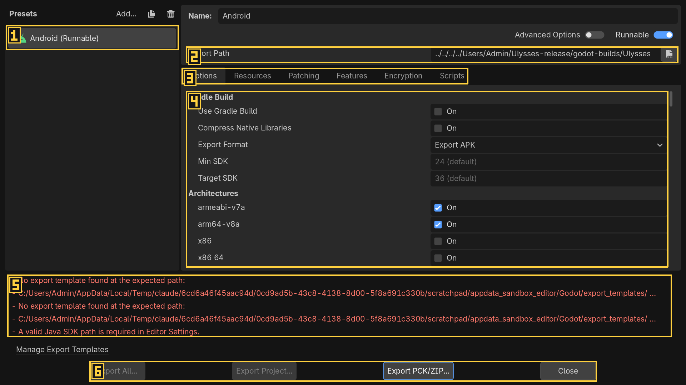

# 11. Saving, phones and shipping

## The save file: ConfigFile

`scripts/save_data.gd` is the game's database layer. It stores everything in one INI-style file, `user://save.cfg`:

```ini
[scores]
high_score=426
rescued_total=14
[bank]
coins=140
[settings]
music=1
vibrate=1
[missions]
active=1315
```

A table lists every field with its section and default:

```gdscript
const FIELDS := {
	"high_score": ["scores", "high_score", 0],
	"coins": ["bank", "coins", 0],
	"vibrate": ["settings", "vibrate", 1],
	...
}
```

`load_all()` returns a dictionary with every field (defaults for a first run); `save_all({...})` writes only the fields you pass and keeps the rest. Adding a field is one line and needs no migration: an old file simply lacks it and gets the default.

**Alternatives:** JSON (`FileAccess` + `JSON`), Godot's binary `var_to_bytes`, or saving a `Resource`. ConfigFile is human-readable, forgiving of missing keys, and enough for a few dozen numbers. A bigger game with inventories would save a Resource or JSON.

## Banking a run (and never twice)

A run's coins and rescues are added to the save at game over, after a Continue's second ending, when leaving from the pause menu, and when the app goes to the background or closes:

```gdscript
func _bank_run() -> int:
	var data := SaveData.load_all()
	var best := maxi(score(), data.high_score)
	SaveData.store(best, data.coins + coins - _banked_coins, data.rescued_total + rescued - _banked_rescued)
	_banked_coins = coins           # remember what is already in the file
	_banked_rescued = rescued
	return best
```

Only the difference since the last bank is added: the same idea as an idempotent write keyed by "what I already sent".

## Phones: lifecycle, touch, vibration

- **Lifecycle**: `_notification(what)` receives `NOTIFICATION_APPLICATION_PAUSED` when the app is sent to the background (pause the run, bank it) and `NOTIFICATION_WM_CLOSE_REQUEST` on close.
- **Touch**: the joystick reads touch events directly, and mouse events too, so it works on desktop. `ButtonFeel` gives buttons a press response that works with fingers.
- **Vibration**: `Input.vibrate_handheld(40)` on hits, if the setting is on. Android needs the **vibrate permission**, turned on in the export preset.
- **Screen**: portrait 180 × 320, stretched to fit.

## Exporting an Android APK

One-time setup:

1. Export templates for 4.7.2 (Editor → Manage Export Templates).
2. **JDK 17** and the **Android SDK** (command-line tools, platform-tools, build-tools, a platform), with their paths in Editor Settings → Export → Android.
3. A debug keystore (Godot makes one) for test builds; the release keystore for the Play Store is kept outside the repo and never committed.



Chapter 2 walks through this dialog box by box. The preset in `export_presets.cfg` sets the package name, version, architectures (arm64 and armv7), minimum and target SDK, icon and permissions. Then:

```
godot --path ulysses-godot --headless --export-debug "Android" C:\path\to\Ulysses-test.apk
```

`.gitignore` blocks `*.apk`, `*.aab`, `*.keystore` and `*.jks`, so builds and signing keys can't be committed by accident.

**For a Play Store release** you would use the release keystore (passwords from environment variables, not files), a higher `versionCode` than the live app, the real package name, and an AAB (Android App Bundle) instead of an APK.

## Exporting for the web

The same project exports to a web page: Godot compiles the engine to **WebAssembly** and draws with **WebGL 2**, which is why the Compatibility renderer (chapter 2) matters here too. The **Web** preset in `export_presets.cfg` sets:

- **Thread support off.** A multi-threaded web build needs the server to send two security headers (cross-origin isolation) that GitHub Pages can't set. Single-threaded builds run anywhere; this game doesn't need threads.
- **Desktop texture compression only.** The pixel art is imported lossless, so phones load the same textures.
- **Canvas resize policy "adaptive".** The canvas fills the browser window, and the game's own stretch settings (integer scale) keep the pixels square.

```
godot --headless --path ulysses-godot --export-release "Web" site/play/index.html
```

The export is an `index.html` with `index.js` (the loader), `index.wasm` (the engine, about 40 MB, the same for every build of this Godot version) and `index.pck` (the game itself, about 5.5 MB). Browsers block pages opened as files from loading the rest, so test it through a web server.

On the web, `user://` is the browser's IndexedDB, so saves stay in that browser; the touch stick reads the mouse too; sound starts after the first click or tap, as browsers require.

**Publishing.** `deploy/publish_site.ps1` builds the whole site (this docs library at the root, the game at `/play/`) and pushes it to a separate public repo that GitHub Pages serves, so the source repo can stay private. **Alternatives:** itch.io (upload the same folder as a zip; it handles the security headers, so threaded builds work there too), or a GitHub Actions workflow that downloads Godot and exports on every push (no local step, but a slow download of the export templates each time).
