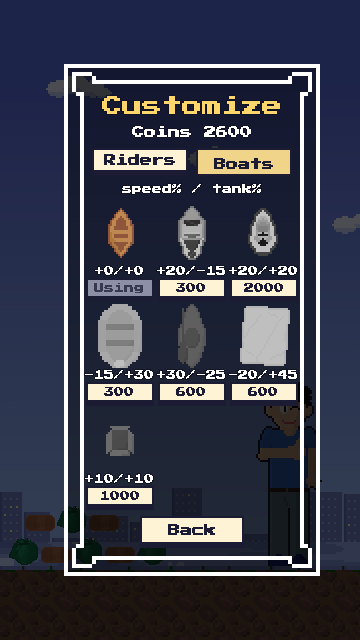

# 13. Where to go next

## Exercises on this codebase

Small to large. Each names the files to read first.

1. **Change a number.** Make the flood faster at the start: `Tuning.SCROLL_SPEED` in `tuning.gd`. Run and feel it. (Then put it back.)
2. **A new boat.** Add an entry to `Characters.BOATS` with a hull image, speed and tank modifiers and a price. It appears in Customize automatically. Bonus: give it a new trait in `boat._apply_trait()`.
3. **A new mission.** Add `{"text": "Collect 400 coins", "stat": "coins", "goal": 400, "reward": 250}` to `Missions.POOL`. Then one that needs a new stat: add the stat to `game.run_stats()`.
4. **A new pickup.** A shield that makes the boat safe for 3 s: a scene like `stopwatch.tscn`, a new `Pickup.Kind`, a branch in `game._on_picked_up`, placement in `spawn_director._place_extras`, and `boat.revive`-style safety.
5. **A new pattern.** A "gate" (two walls three rows apart). Add it to `Tuning.PATTERN_UNLOCKS` and `_build_pattern()`. Run `check_spawn_director` to prove it keeps the safe path.
6. **A new boss attack.** A boss that fires a ring of eight. Add an `attack` and a branch in `boss.fire_wave()`; keep the ring reachable with `pick_ring()`.
7. **A shader.** Make pickups sparkle: add a `sparkle` switch to `sprite_fx.gdshader`.
8. **A new screen.** An achievements page built like the Missions page.

## A learning plan (four weeks)

| Week | Do | Read |
|---|---|---|
| 1 | Godot's "Your first 2D game" tutorial; open Ulysses, run it, change numbers | Chapters 1–3 |
| 2 | Exercises 1–3; read `boat.gd` and `game.gd` line by line | Chapters 4–5 |
| 3 | Exercises 4–6; write one headless test for your change | Chapters 6–7, 12 |
| 4 | Exercises 7–8; export an APK and play it on a phone | Chapters 8–11 |

## Ideas you now know, in game-dev words

| You know (backend) | Game developers call it |
|---|---|
| A request loop | The game loop, frames, `delta` time |
| Pub/sub | Signals, events |
| Dependency injection | Exported references, scene composition |
| Config files | Tuning values, resources |
| Invariants and property tests | Fairness guarantees (the safe path), seeded generation |
| Idempotent writes | Banking a run without counting twice |
| Staging environments | A sandboxed save for tests |
| Monitoring dashboards | Screenshots and play-tests |

The rest is feel: momentum, telegraphs, fair randomness, rewards you can lose. Play other games with this manual in mind and you will start to see the rules underneath them.
